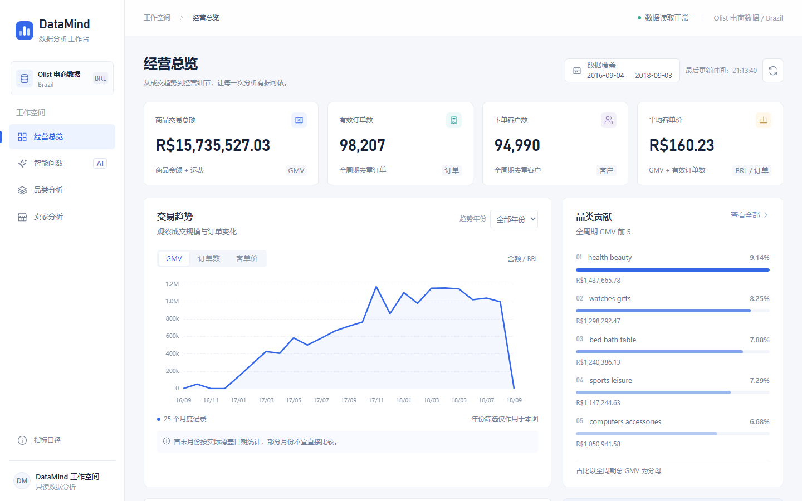
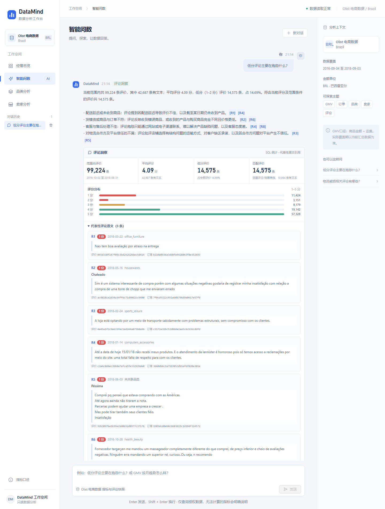

# DataMind 数据分析工作台

基于 Olist 巴西电商公开数据集的一站式数据分析平台：**指标看板 + 自然语言问数（Text-to-SQL）+ 评论语义洞察**。

用中文直接问「最近三个月 GMV 趋势怎么样？」「低分评论主要在抱怨什么？」，系统自动完成意图识别、数据字典检索、SQL 生成与执行、评论语义检索，并返回图表、表格和带原文引用的结论。

## 功能特性

- **指标看板**：经管总览、品类分析、卖家分析，覆盖 GMV、订单量、用户数、客单价、品类排行、卖家排行等核心指标
- **智能问数（Text-to-SQL）**：LangGraph 编排「意图判断 → 数据字典检索 → SQL 生成 → 安全校验 → 执行 → 回答生成」全链路；sqlglot 解析 + 只读账号 + 表白名单 + 超时熔断四重防护，SQL 错误自动重试
- **评论语义洞察**：9.9 万条葡语评论的本地 SQLite FTS5 全文索引；中文问题经模型改写为葡语检索词跨语言召回，BM25 + 多查询 RRF 排序；统计由参数化 SQL 完成，结论带可点击的 `[R1]` 原文引用（review_id / 评分 / 日期 / 品类），模型不可用时降级为纯统计回答
- **数据源接入**：登记外部 MySQL 数据源、在线预览表、快照导入到隔离数据库，平台能力可复用到其他数据集

## 界面预览

**经营总览看板**



**评论语义洞察**（SQL 统计 + 评分分布 + 可点击的原文引用）



## 架构

```
┌────────────────────────┐
│  React 19 + Vite 前端   │  看板 / 对话式问数 / 评论引用展示
└───────────┬────────────┘
            │ /api (Vite 代理 → :8000)
┌───────────▼────────────┐
│   FastAPI 后端          │  指标接口 · 数据字典 · 智能问数 · 数据源接入
│  ┌──────────────────┐  │
│  │ LangGraph Agent  │  │  intent → schema → SQL → guard → execute → respond
│  │  + DeepSeek LLM  │  │              └→ review_insight（评论链路）
│  └──────────────────┘  │
└──────┬───────────┬─────┘
       │           │
┌──────▼─────┐  ┌──▼──────────────┐
│   MySQL     │  │ SQLite 评论索引  │  FTS5 全文索引，源 CSV 变更自动重建
│ ODS→DWD→   │  └─────────────────┘
│ DWS→ADS    │
└──────▲─────┘
       │ PySpark ETL（四层建模）
┌──────┴─────┐
│ data/raw/  │  Olist 原始 CSV（需自行下载，见 data/raw/README.md）
└────────────┘
```

## 技术栈

| 层 | 技术 |
|---|---|
| 前端 | React 19 · Vite 7 · Ant Design 6 · ECharts 6 |
| 后端 | FastAPI · Uvicorn · SQLAlchemy 2 + aiomysql |
| Agent | LangGraph · DeepSeek API · sqlglot（SQL 安全校验） |
| 评论检索 | SQLite FTS5 · BM25 · Reciprocal Rank Fusion（无额外向量库依赖） |
| 数仓 | PySpark 3.5 · MySQL 8 · ODS/DWD/DWS/ADS 四层建模 |

## 目录结构

```
├── frontend/        # React 前端（看板 + 问数界面）
├── backend/         # FastAPI 服务（指标 / 数据字典 / 问数 / 数据源）
├── agent/           # LangGraph 智能问数与评论洞察 Agent
│   ├── nodes/       #   意图、Schema 检索、SQL 生成/执行、评论洞察等节点
│   └── review_store.py  # 评论 SQLite FTS5 索引
├── etl/             # PySpark 四层 ETL（ods → dwd → dws → ads，run_all.py 一键运行）
├── docs/            # 详细设计、安装配置、进度文档
└── data/raw/        # 原始数据集（需自行下载，见该目录 README）
```

## 快速开始

### 环境要求

- Python 3.10–3.12 · Node.js 18+ · MySQL 8 · JDK 11（ETL 用）

### 1. 下载数据集

按 [`data/raw/README.md`](data/raw/README.md) 指引，从 Kaggle 下载 9 个 CSV 放入 `data/raw/`。

### 2. 初始化 MySQL 并跑 ETL

```bash
# 参考 docs/mysql_readonly_init_template.sql 创建只读查询账号
# ETL 账号密码通过环境变量提供（默认 123456 仅供本地开发）
export DATAMIND_ETL_PASSWORD=你的密码   # Windows: set DATAMIND_ETL_PASSWORD=...
python etl/run_all.py                  # 一次性完成 ODS→DWD→DWS→ADS
```

### 3. 配置 Agent 密钥

```bash
cp agent/.env.example agent/.env
# 填写 DEEPSEEK_API_KEY、DATAMIND_QUERY_PASSWORD（只读账号密码）
```

### 4. 启动后端（端口 8000）

```bash
pip install -r backend/requirements.txt -r agent/requirements.txt
cd backend && python -m uvicorn main:app --reload --port 8000
# 健康检查：curl http://localhost:8000/health
```

### 5. 启动前端（端口 5173）

```bash
cd frontend && npm install && npm run dev
# 打开 http://127.0.0.1:5173
```

评论索引在首次提问评论类问题时自动构建（约 2–3 秒），无需手动操作。

## 主要环境变量

| 变量 | 默认 | 说明 |
|---|---|---|
| `DEEPSEEK_API_KEY` | — | **必填**，DeepSeek 模型密钥 |
| `DATAMIND_QUERY_PASSWORD` | — | **必填**，MySQL 只读查询账号密码 |
| `DATAMIND_ETL_PASSWORD` | `123456` | ETL 写入账号密码（本地默认值，勿用于生产） |
| `DATAMIND_BACKEND_URL` | `http://localhost:8000` | Agent 回调数据字典的地址 |
| `DATAMIND_REVIEW_INDEX_PATH` | `data/review_index/reviews.sqlite3` | 评论索引路径 |

## 测试

```bash
# 后端与 Agent（均为离线测试，不依赖真实模型/MySQL）
python agent/test_review_store.py && python agent/test_review_insight.py
python agent/test_concentrated.py && python backend/test_chat_router.py

# 前端
cd frontend && npm test && npm run build
```

## 安全设计

- 智能问数仅允许查询 ADS/DWS 授权汇总表：只读账号 + sqlglot 白名单解析 + 禁多语句/锁表 + 15s 查询超时 + 结果行数截断
- 评论检索的过滤条件白名单构造，FTS 查询做字面词转义，模型生成的引用编号经白名单校验，提示词将评论文本声明为不可信数据
- 密钥只走环境变量 / `.env`（已 gitignore），仓库内无任何真实凭据

## 文档

- [安装运行与配置说明](docs/安装运行与配置说明.md)
- [项目进度总结](docs/项目进度总结.md)
- [MySQL 真实数据接入](docs/MySQL真实数据接入.md)

## 许可

- **代码**：[MIT License](LICENSE)——可自由使用、修改、商用，只需保留版权声明
- **数据集**：Olist 公开数据集，[CC BY-NC-SA 4.0](https://creativecommons.org/licenses/by-nc-sa/4.0/)，请勿商用；数据文件不包含在本仓库中
